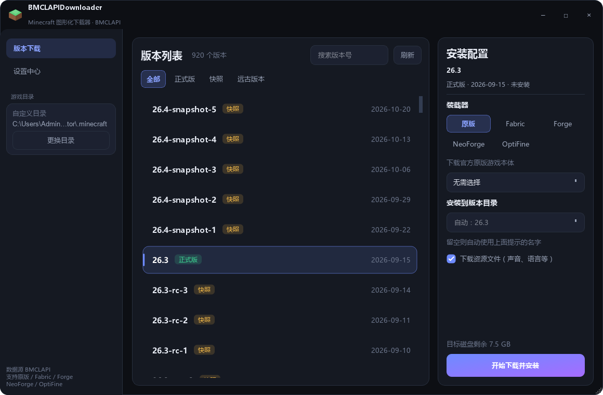
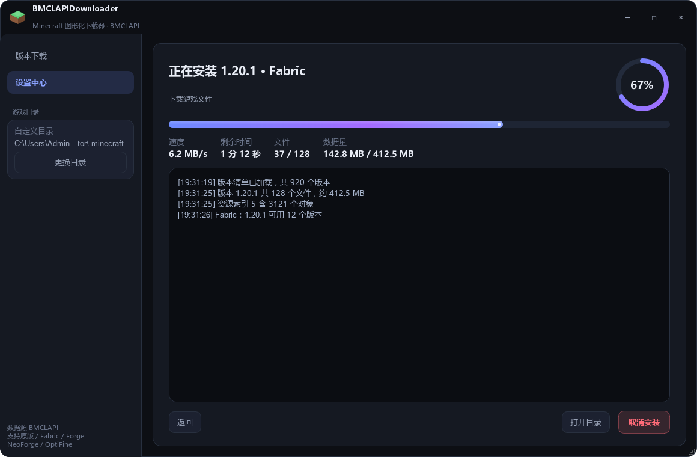
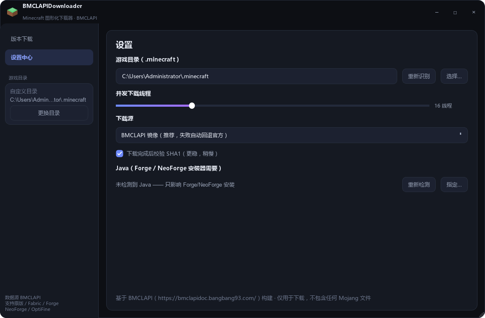

# BMCLAPIDownloader · Minecraft 图形化下载器

> 版本 **0.1.0** · 单文件 exe 约 21 MB · Windows 7+

**[⬇ 下载 BMCLAPIDownloader.exe](https://github.com/imgjx/BMCLAPIDownloader/releases/latest)**

基于 [BMCLAPI](https://bmclapidoc.bangbang93.com/) 的 Minecraft 下载工具，纯 Python + PyQt5，
替代已经跑路的 PCL2 下载功能。国内网络友好（镜像加速 + 自动回退官方源）。

## 功能

- **版本下载**：正式版 / 快照 / 远古版本全覆盖，搜索 + 分类筛选
- **原版完整安装**：客户端 jar、依赖库（含平台规则判断）、资源索引与全部 objects、
  日志配置、老版本 natives 解压、1.6 及更早的 `assets/virtual` 展开
- **模组加载器**
  - Fabric：纯 JSON 安装，最快，不需要 Java
  - Forge / NeoForge：自动下载安装器并调用本机 Java 运行（`--installClient`）
  - OptiFine：下载对应版本安装包到 `.minecraft/optifine/`（安装器带 GUI，需手动点一下）
- **游戏目录自动识别**
  - 官方启动器 `%APPDATA%\.minecraft`
  - PCL2 / HMCL 绿色版的 `.minecraft`（从 `PCL/`、`HMCL/`、`PCL.ini` 等痕迹判断归属）
  - 从 `launcher_profiles.json` 里的 `gameDir` 反查
  - 全盘浅层扫描（深度 3，自动剪掉系统目录），按「版本数量」排序
- **下载引擎**
  - 多线程并发（1–64 可调，默认 16）
  - 断点续传（`.part` + Range）
  - SHA1 校验（可关，关了更快）
  - 镜像优先、失败自动回退官方源；也可强制只用某一侧
- **安装到指定版本目录**
  - 装到 `versions` 下哪个文件夹名，可以在安装面板里直接改
  - 下拉里会列出该 `.minecraft/versions` 已有的目录，选一个就是覆盖更新它
  - 留空则自动命名（`1.20.1` / `fabric-loader-0.16.9-1.20.1` / `1.20.1-forge-47.3.0`）
  - 名字会做 Windows 非法字符、保留名、长度校验；Forge/NeoForge 装完自动改名并同步 json 里的 id
- **顺手做的事**：往 `launcher_profiles.json` 写一条 profile，官方启动器也能直接看到新版本

## 界面







- 无边框深色窗口，圆角卡片、渐变强调色、自绘等距草方块图标
- 尺寸自适应：按屏幕可用区域决定初始大小并居中，最小尺寸跟随屏幕缩放；
  左列表与右面板按比例伸缩，小到 920×620、大到 1600×900 都不挤
- 复选框、芯片按钮、进度条等控件全部自绘，不受系统主题影响
- 版本列表用 `QAbstractListModel + QStyledItemDelegate` 自绘，上千条也不卡
- 进度条带缓动动画与流光，环形进度盘显示百分比
- 实时速度 / 剩余时间 / 文件计数，完整日志面板

## 直接运行

```bat
build.bat        :: 首次：建虚拟环境、装依赖、生成图标、打包 exe
run.bat          :: 调试运行源码
```

或者手动：

```bash
python -m venv .venv
.venv\Scripts\pip install -r requirements.txt -i https://mirrors.aliyun.com/pypi/simple/
.venv\Scripts\python tools/make_icon.py
.venv\Scripts\python main.py
```

## 打包

```bat
build.bat
```

产物：`dist\BMCLAPIDownloader.exe`（单文件、无控制台窗口，**约 21 MB**）。

瘦身做法（`build.spec` 里的 `_slim`）：纯 QWidget 应用用不到的 Qt 组件全部剔除 ——
`opengl32sw.dll`（20 MB 的软件 OpenGL 渲染器）、Qt5Qml / Qt5Quick、ANGLE 的
`d3dcompiler_47` / `libGLESv2`、Qt5Network、Qt5DBus、多余的平台与图片格式插件、
Qt 翻译文件。体积从 37 MB 降到 21 MB，启动反而更快。

## 目录结构

```
mc-downloader/
├─ main.py               入口（异常兜底、DPI、图标）
├─ app/
│  ├─ paths.py           .minecraft / PCL / HMCL 目录识别与扫描
│  ├─ net.py             镜像映射、Client、多线程下载器
│  ├─ api.py             BMCLAPI 接口、rules 判断、任务计划生成
│  ├─ installer.py       安装编排：原版 / Fabric / Forge / NeoForge / OptiFine
│  ├─ config.py          配置持久化（%APPDATA%\BMCLAPIDownloader\config.json）
│  ├─ theme.py           配色 + 全局 QSS
│  ├─ widgets.py         自绘控件（图标 / 进度条 / 标题栏 / 列表代理）
│  └─ main_window.py     主窗口
├─ tools/make_icon.py    生成多尺寸 ico（纯 Qt，不依赖 Pillow）
├─ build.spec            PyInstaller 配置
├─ build.bat / run.bat
└─ requirements.txt
```

## 说明

- **只做下载与安装，没有任何启动游戏的功能**（按需求刻意不做）。
  装完用你自己习惯的启动器（PCL2 / HMCL / 官方启动器）启动即可
- 不包含任何 Mojang 文件，全部由官方/镜像服务器实时下载
- Forge / NeoForge 需要本机已有 JDK 17+，设置页会显示检测结果
- 玩 1.12.2 及更老的整合包时，请用 Java 8；新版用 Java 17/21
- `%APPDATA%\BMCLAPIDownloader\config.json` 里只存路径与偏好，不含账号信息
- 万一启动崩溃，完整 traceback 会写到 `%APPDATA%\BMCLAPIDownloader\crash.log`
- 从旧版（`%APPDATA%\MCDL`）升级会自动迁移一次配置
